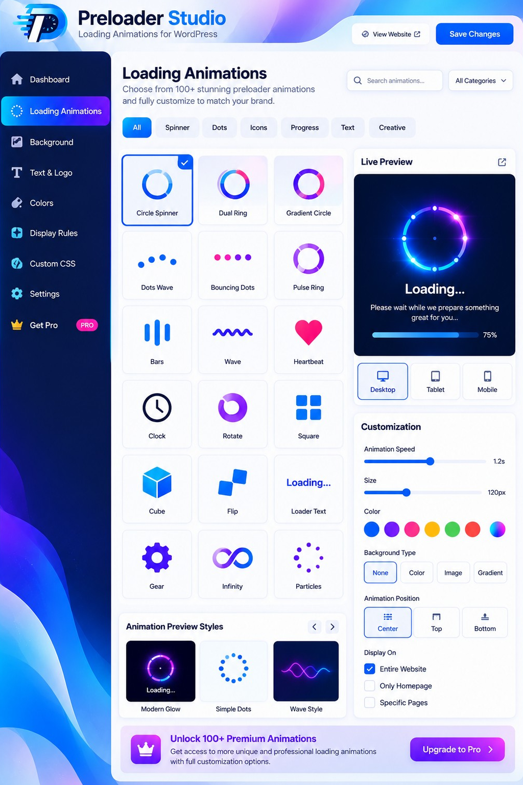
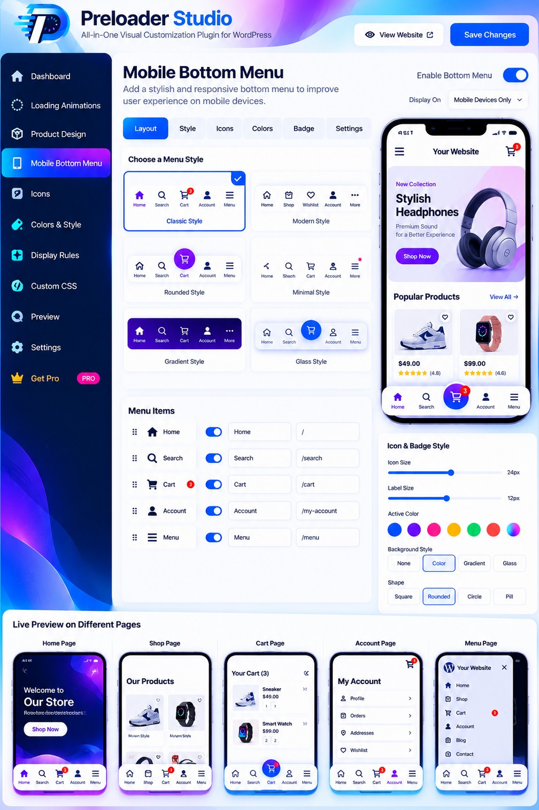

# Preloader Studio – Animated Loading Screens

## 📸 Plugin interface gallery

| 🔄 Loading Animations | 🛍️ Product Design | 📱 Mobile Bottom Menu |
|:---:|:---:|:---:|
|  |  |  |

*These are illustrative UI previews. Actual plugin screens and capabilities may differ; refer to the WordPress.org `readme.txt` and the installed plugin for supported features.*

### ✨ Included design tools

- **🔄 Loading Studio:** 36 CSS animations, live previews, page and device rules.
- **📱 Mobile Navigation:** 24 bundled navigation styles and flexible links.
- **🛍️ WooCommerce Product Layouts:** 32 styles for product cards and optional single-product presentation.
- **🔐 Account Interfaces:** six login, registration and recovery design templates.
- **⚙️ Flexible Settings:** independently controlled overrides and theme compatibility options.

---

**WordPress.org slug:** `preloader-studio-animated-loading-screens`  
**Current version:** `2.6.5`  
**Maintainer / WordPress.org account:** `codelith`  
**License:** GPLv2 or later

This is the complete readable source of the Preloader Studio plugin. Source and runtime scripts, licensing information, and the WordPress.org `readme.txt` are included. The installable plugin has its main `preloader-studio.php` directly in the repository root.

## First release from GitHub to WordPress.org

The WordPress.org hosting request has already been approved and transferred to `codelith`. **Do not create a new plugin submission.** You need SVN commit access for `codelith` before deploying.

1. Create a **public** GitHub repository, ideally named `preloader-studio-animated-loading-screens`.
2. Upload **the contents of this extracted folder** into the repository root (not the ZIP file). Verify that `.github/workflows/deploy-wordpress.yml` and `.distignore` were uploaded as well.
3. In GitHub: **Settings → Secrets and variables → Actions → New repository secret**. Add:
   - `SVN_USERNAME` = `codelith`
   - `SVN_PASSWORD` = the **SVN-specific password** from https://profiles.wordpress.org/me/profile/edit/group/3/?screen=svn-password
4. Ensure the secret values are saved, and your `codelith` user has WordPress.org SVN commit permission.
5. On GitHub, open **Releases → Draft a new release**. Create the new numeric tag `2.6.5` from the `main` branch. Publish it as a normal release (**not a pre-release**).
6. Go to **Actions → Publish Preloader Studio to WordPress.org** and confirm the run succeeds. The 10up deployment action publishes the release files to SVN `trunk/` and `tags/2.6.5/`.
7. Verify https://wordpress.org/plugins/preloader-studio-animated-loading-screens/ after WordPress.org processes your SVN commit.

GitHub is the **development source**. WordPress.org's SVN is the **public release system**. Uploading a GitHub ZIP alone does not publish your plugin to WordPress.org.

## How the package is made

- Everything needed to install the plugin is at the GitHub repository root.
- `.distignore` prevents GitHub-only files (`README.md`, `.github/`, etc.) from being sent to WordPress.org.
- Runtime JS and its matching human-readable source are under `assets/js/` and `assets/js/src/`; rebuilding instructions are in `SOURCE-README.txt`.
- WordPress.org directory listing images are included in `.wordpress-org/`: `icon-128x128.png`, `icon-256x256.png`, `banner-772x250.png`, and `banner-1544x500.png`. The deploy action automatically transfers them to the SVN top-level `/assets/` directory. They are NOT runtime plugin assets.
- Do not commit passwords, tokens, or personal information to this public repository. Use GitHub Actions Secrets.

## Quality checks

For local PHP: `find . -name '*.php' -exec php -l {} \;`  
For JS: `find assets/js -name '*.js' -exec node --check {} \;`

Do real WordPress and WooCommerce compatibility checks on a staging site, even if automated checks pass. See `PUBLISH-BN.md` for a Bengali publication checklist.
